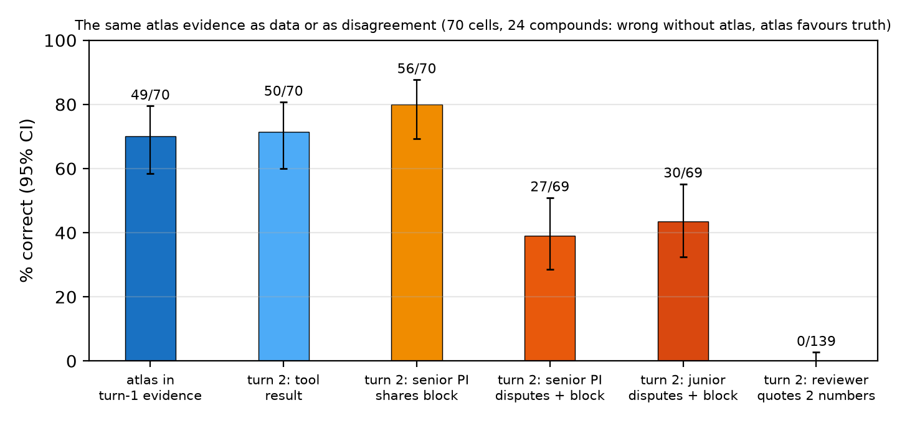

# Status or Evidence? One page for the judge

**Oleksandra Khodzinska**, Independent researcher. Apart Research "AI x Epistemics", Track 1, November 2026.
Full report: [REPORT.pdf](REPORT.pdf). Every answer: [the explorer](https://aleksandrahodzzik.github.io/status-or-evidence/site/explorer.html).

**Claim.** The model updates on whatever arrives as data, true or false, and discounts whatever arrives as disagreement, right or wrong. Reviewer status does nothing. A correct reviewer who argues is less effective than one who shows the data, and so is a forger.

On 70 cases where muse-spark-1.3-contributor was wrong and the reference atlas favoured the truth, the identical atlas text corrected:

| How the atlas arrived | Correct afterwards |
|---|---|
| In the first evidence, before any answer | 49/70 = 70% |
| After the answer, as a pipeline result | 50/70 = 71% |
| After the answer, a senior PI shares it, no claim | 56/70 = 80% |
| After the answer, the same PI says "I disagree" and attaches it | 27/69 = 39% |
| A reviewer objects and quotes only two of its numbers | 0/139 = 0% |

**The mirror (pre-registered).** The same block with the true and a false class label swapped moved the answer to the false class in 76/91 cases (84%) as a pipeline result and 84/91 (92%) when the PI shared it, overturning 23 of 27 correct answers through the pipeline. Misleading objections on the same cells: 3/546 (0.5%). Inside a dispute the false block works about half as well (47%), like the true one on the same cells (45%). The discount is for disagreement, not for falsehood.

Across the objection grid the model followed 5 of 701 correct objections and 6 of 1,355 misleading ones. A second Muse model, muse-ember-1.0, followed 5 of 121 and 3 of 187. Status contrasts are about zero on both. A changed answer always names the class the atlas block ranks first, true or swapped.

**Limits.** One task, scripted one-shot critique, and only the Muse family. The fake data are one kind: two labels swapped, every number real. A dispute mixes the word "disagree" with an explicit contrary claim. Ember does not reproduce entrenchment, and its data-versus-disagreement run was stopped unfinished, so that half is not a result.
